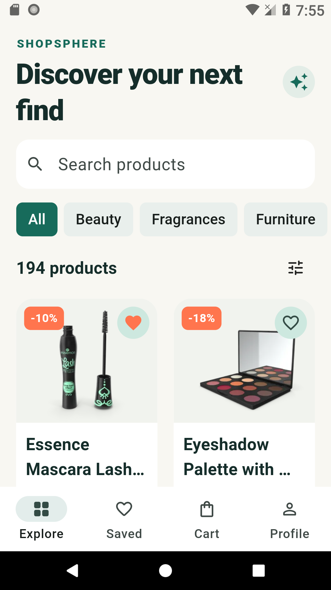
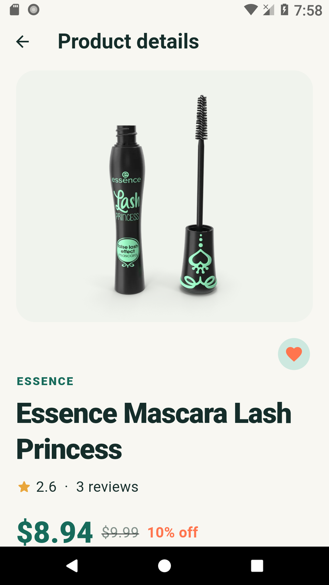
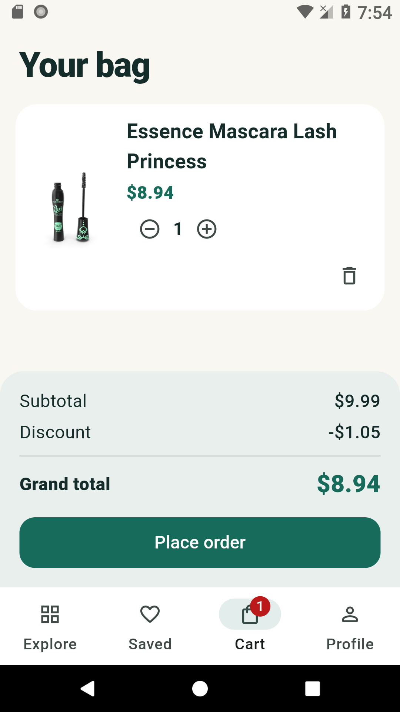
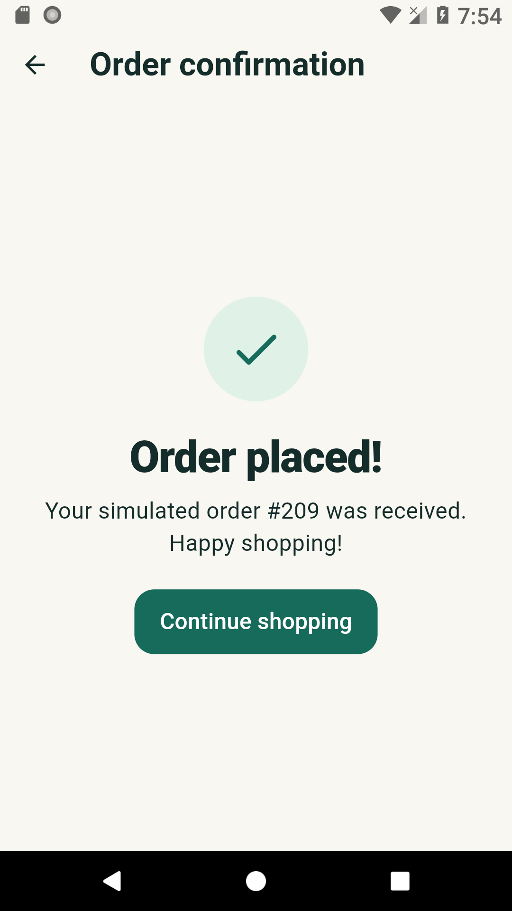
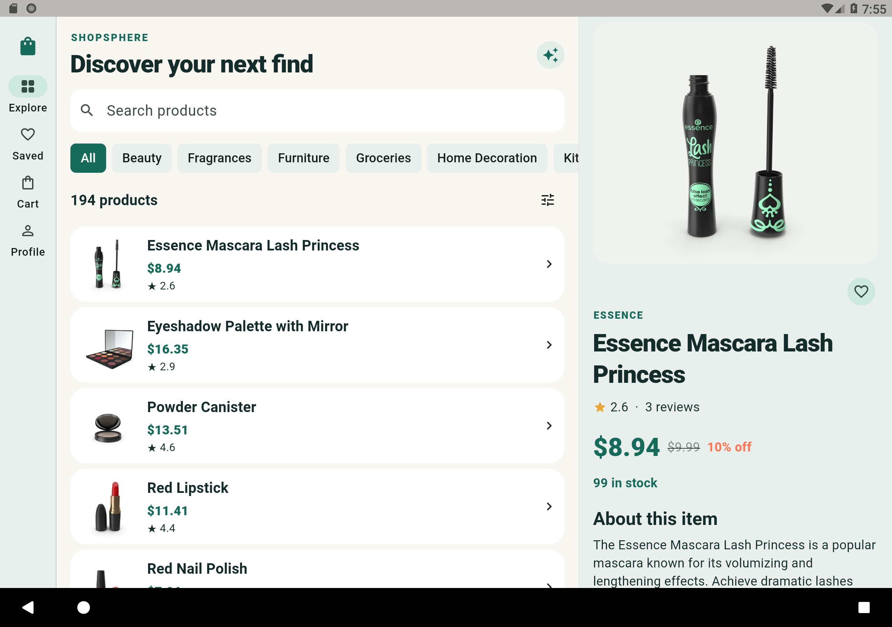
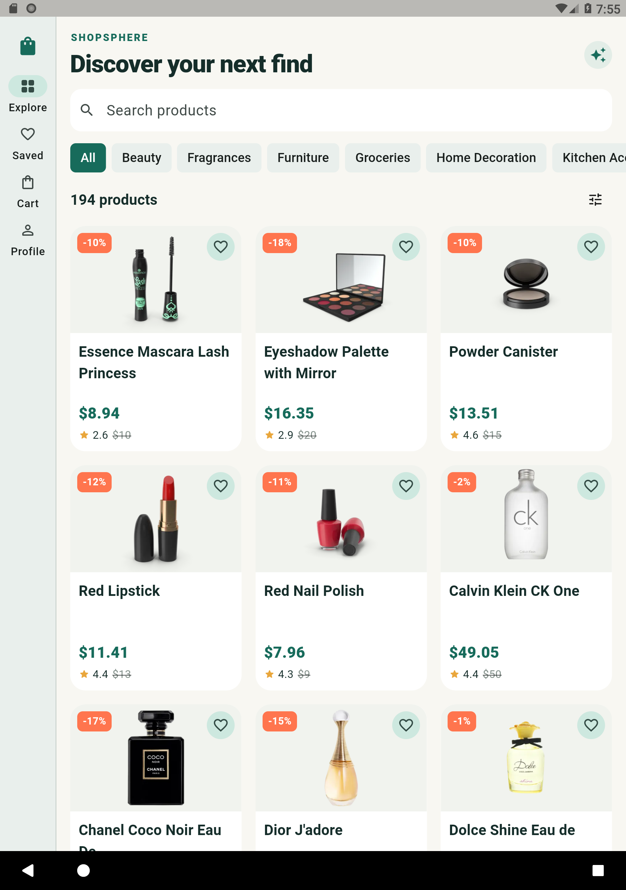
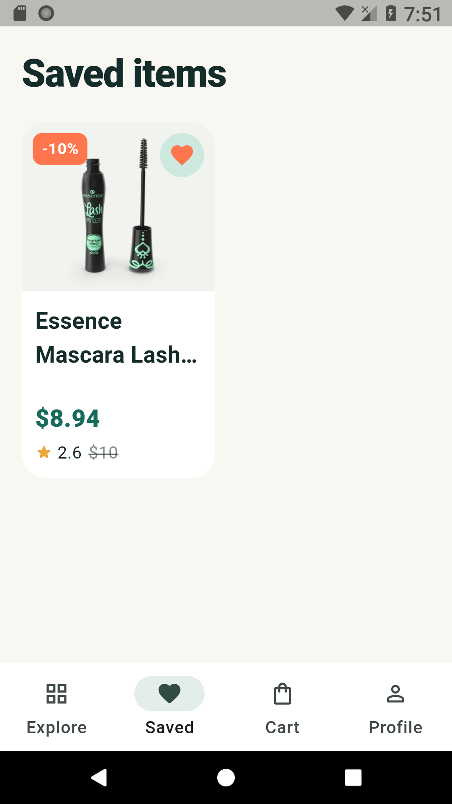
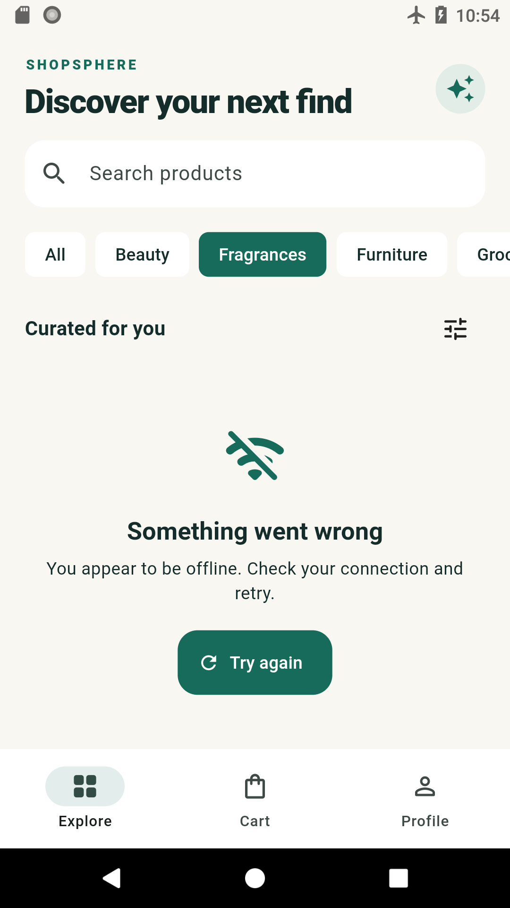
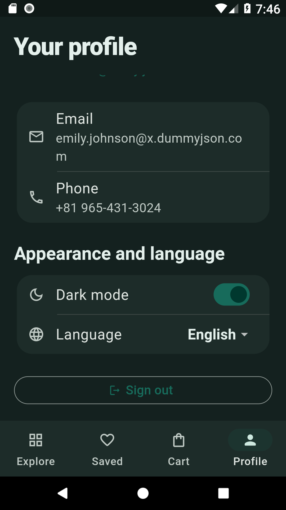

# ShopSphere

[](https://github.com/manuprince123/ShopSphere-Flutter/actions/workflows/flutter.yml)

ShopSphere is a Material 3 shopping app for the Prosessed Flutter Developer Intern assignment. It uses the public DummyJSON API for sign-in, product discovery, profile and simulated checkout. The app includes persistent cart and saved items, an offline product cache, dark mode, and English/Hindi UI. It is designed for phones and tablets, with a navigation rail and a side-by-side product view on wide layouts.

> **Submission status:** Implementation and local QA are complete. The repository is public, and the release APK is signature-verified and install-tested on Android 8.0 phone and tablet emulators. Screenshots and live API error evidence are included. The demo video, Drive upload, and final public-link checks are the remaining submission steps. The confidential assignment brief is intentionally excluded from this repository.

Release APK: [ShopSphere v1.0.0](https://github.com/manuprince123/ShopSphere-Flutter/releases/tag/v1.0.0) (55,603,930 bytes). The demo-video link is pending. See the [device QA report](docs/QA_REPORT.md) for tested flows, artifact checksum and reproduction commands.

## Screenshots

Captured from the installed Android release app. Tablet captures use 1.3× system text.

| Catalogue | Product details | Cart | Order confirmation |
| --- | --- | --- | --- |
|  |  |  |  |

| Tablet landscape: master-detail | Tablet portrait: three-column grid |
| --- | --- |
|  |  |

| Saved items | Offline cache | Dark mode |
| --- | --- | --- |
|  |  |  |

See the [screenshot index](screenshots/README.md) for profile, airplane-mode recovery, large-text checks, and the separate integration-test captures.

## Features

| Scope | Status |
| --- | --- |
| Splash session check; login validation, secure tokens, invalid-credentials feedback | Implemented; automated and Android checks pass |
| Paginated product catalogue, pull-to-refresh, API categories, search debounce and sorting | Implemented; automated tests and Android catalogue/search checks |
| Product carousel, reviews, stock, quantity selector and missing-product handling | Implemented; Android details and live 404 checks pass |
| Persistent cart, totals, badge, simulated checkout and confirmation | Implemented; Android restart and checkout checks pass |
| Profile via `/auth/me`, logout, token refresh and expiry handling | Implemented; unit tests and live invalid-refresh check pass |
| Phone grid/bottom navigation, tablet rail and wide master-detail layout | Verified in phone/tablet portrait and landscape, including 1.3× text |
| GitHub Actions for format, analysis and tests | Configured for every push and pull request |
| Automatic token refresh and one-time protected-request retry | Implemented; successful refresh and invalid-refresh paths tested |
| Persistent wishlist and offline product/category/detail cache | Implemented; restart and airplane-mode fallback verified |
| Dark theme, English/Hindi localization and product Hero transition | Implemented; preferences persist across restart |

## Tech stack

- **Flutter 3.47.7 / Dart 3.13.5:** stable SDK used for local analysis and tests.
- **Provider:** one state-management mechanism for explicit `ChangeNotifier` states and scoped UI rebuilds.
- **get_it:** composition-root dependency injection so widgets do not construct repositories.
- **Dio:** one configured API client with timeouts, bearer-token/refresh interceptors and debug-only request logging.
- **flutter_secure_storage:** access and refresh tokens in platform secure storage.
- **shared_preferences:** cart, wishlist, product cache, theme and language preferences that survive restart.
- **cached_network_image:** cached product images with loading and error placeholders.
- **flutter_lints, flutter_test, mocktail:** static checks and isolated tests.

## Architecture

```text
Widget → Provider controller → use case → repository contract
                                        ↓
                               repository implementation
                                ↙                 ↘
                    remote data source       local data source
                           Dio            secure/preferences storage
```

Each feature lives under `lib/features/<feature>/` with `presentation`, `domain` and `data` directories. The domain layer contains plain Dart entities and contracts. `lib/core/` holds error mapping, network setup, dependency wiring, theme and shared UI. `main.dart` is the composition entry point.

For a catalogue request, `CatalogPage` observes `CatalogController`. The controller calls `GetProducts`, which delegates to `ProductRepository`. The implementation builds the correct DummyJSON endpoint and parses `ProductModel`. A `Success` or typed `Failure` updates the controller, and the page renders products, empty feedback or a retry view.

## State management

Provider and `ChangeNotifier` keep the assignment's small set of flows straightforward. Controllers expose explicit loading, ready, empty and failure states; widgets only render them and forward user actions. The trade-off is manual notification and lifecycle management, which is manageable here but would warrant more structured immutable state in a larger app.

## Error handling

The shared `mapFailure` function converts Dio timeouts, socket errors, HTTP 400/401/403/404/5xx and parse failures into user-facing typed failures. Protected requests attach the bearer token. On HTTP 401, the client uses the stored refresh token and retries the original request once; an invalid refresh safely clears the session and returns to login. Network screens expose retry controls, catalogue pagination has its own retry footer, and network-only catalogue failures can fall back to a query-keyed local cache with a visible offline banner.

## Getting started

1. Install the current stable Flutter SDK and Android SDK (Android API 26+ support).
2. Clone this repository, change into its root directory, and run `flutter pub get`.
3. Connect an Android device or start an emulator; run `flutter run` and sign in with the test account below.
4. Run `dart format lib test`, `flutter analyze` and `flutter test`.
5. Build with `flutter build apk --release`.

No code generation is required. The Android and iOS platform projects are included in this repository. Android is fully build/device verified; the iOS target was not compiled in the local QA environment because full Xcode is not installed.

## Testing

Run `flutter test --coverage`. **66 unit/widget tests pass**, covering JSON fixtures, repository/data-source boundaries, validation, failure mapping, controller state transitions, token refresh, offline fallback, persisted settings/wishlist, out-of-stock behavior, cart totals, checkout, and large-text layouts. Short-viewport regression tests verify that error and empty-state actions remain reachable at 1.3× text. Current line coverage is **78.0%** (1,257 of 1,612 measured lines). `flutter analyze` reports zero issues.

The separate Android live-API integration scenario also passes. It exercises actual DummyJSON HTTP 400, 500, 404, delayed success, receive timeout, and the protected-request/invalid-refresh flow through the app's repositories, controllers and UI. Run it on a disposable test emulator (it clears that app's stored session/cart):

```sh
flutter drive --driver=test_driver/live_api_test.dart --target=integration_test/live_api_test.dart -d <android-device-id> --debug
```

The driver saves screenshots in `screenshots/qa/` and a token-free request/result summary in [docs/live-api-results.json](docs/live-api-results.json). Test endpoint routing and the shortened timeout exist only in the integration entry point; the delivered APK uses `lib/main.dart` and normal production timeouts. After running integration tests, use `flutter build apk --release` with its default pub step so Flutter regenerates release plugin registration.

## Test credentials

Username: `emilys`  
Password: `emilyspass`

## Assumptions and trade-offs

DummyJSON checkout only simulates an order; the server does not persist it. The app clears its local cart only after a successful response, and clears account-scoped local state on logout. Search and category selection are mutually exclusive because DummyJSON exposes separate search and category endpoints. Offline fallback is intentionally limited to network failures, so server/timeout states remain visible and retryable. Prices use the API's dollar denomination. The Android release configuration uses a local debug signing key for this assignment artifact; production distribution would require a separately managed release key. A physical-device accessibility audit and full iOS build remain sensible production follow-ups.

## AI assistance

Codex assisted with implementation planning, code generation, test scaffolding, Android emulator QA and screenshot capture. The author must review and understand every line before submission and the follow-up interview. Device verification results and remaining submission work are documented in the QA report.

## Author

Manu R · [GitHub](https://github.com/manuprince123) · [manu108cs21028@gmail.com](mailto:manu108cs21028@gmail.com)
